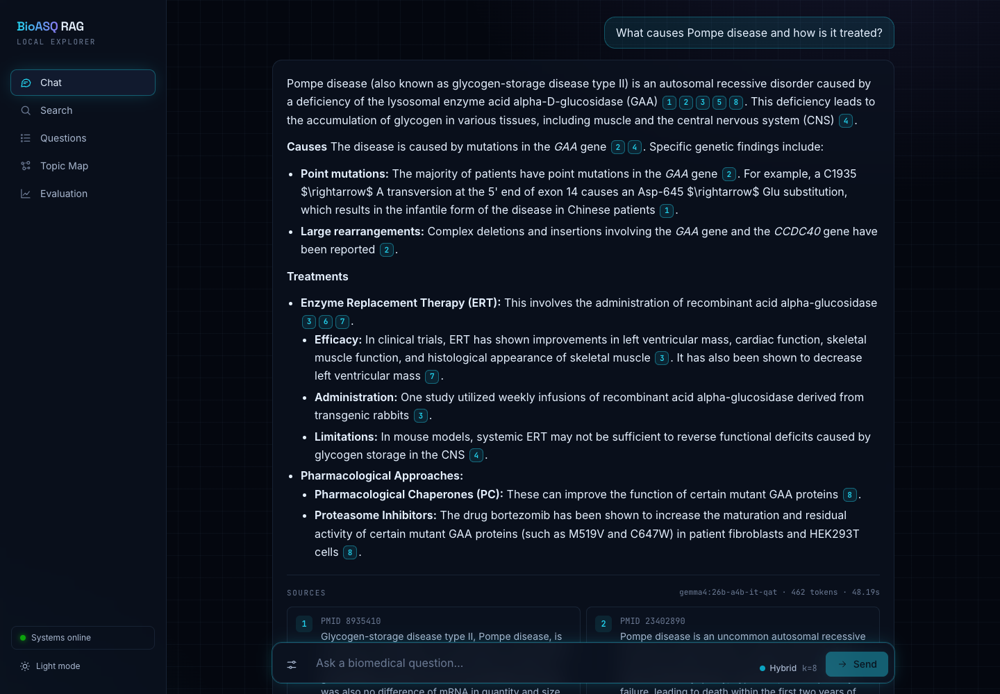
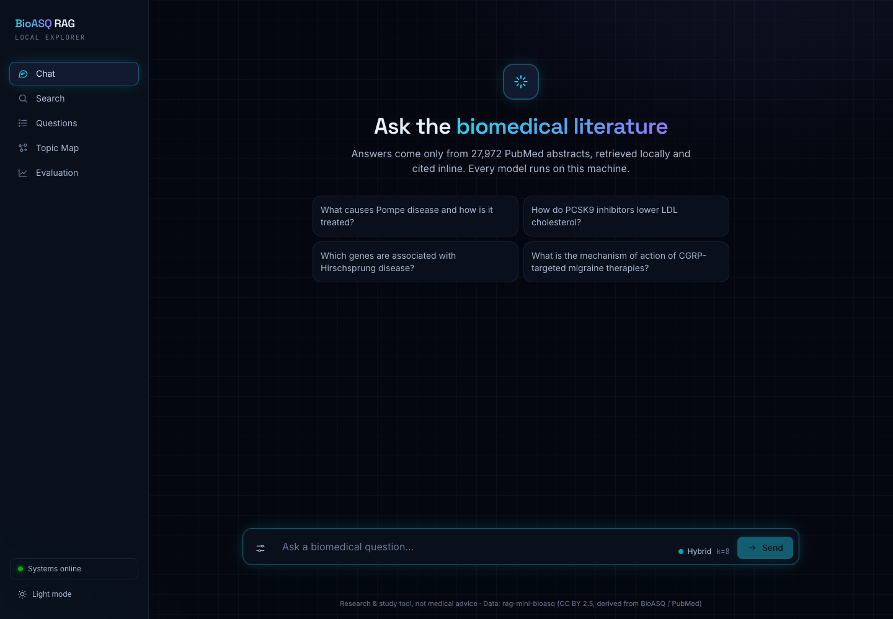
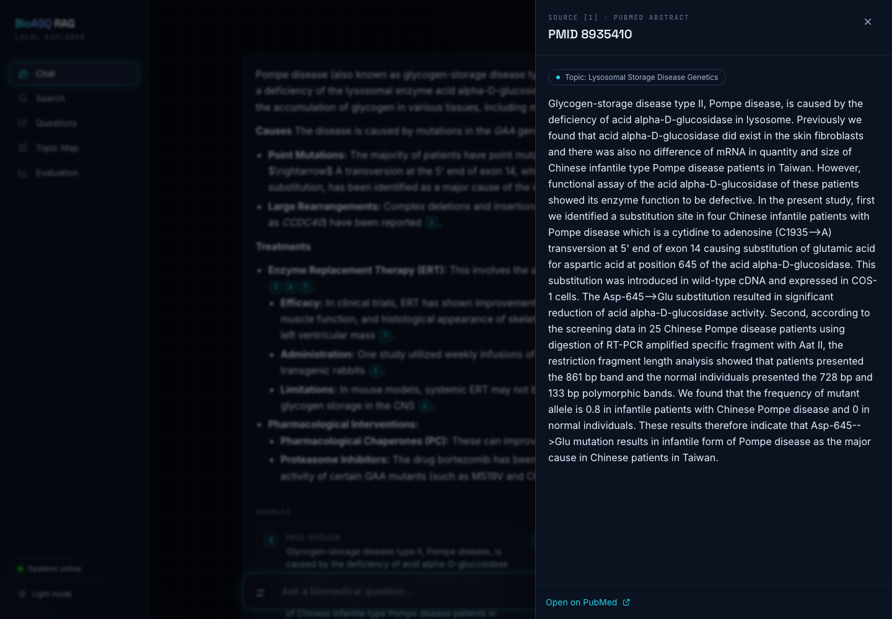
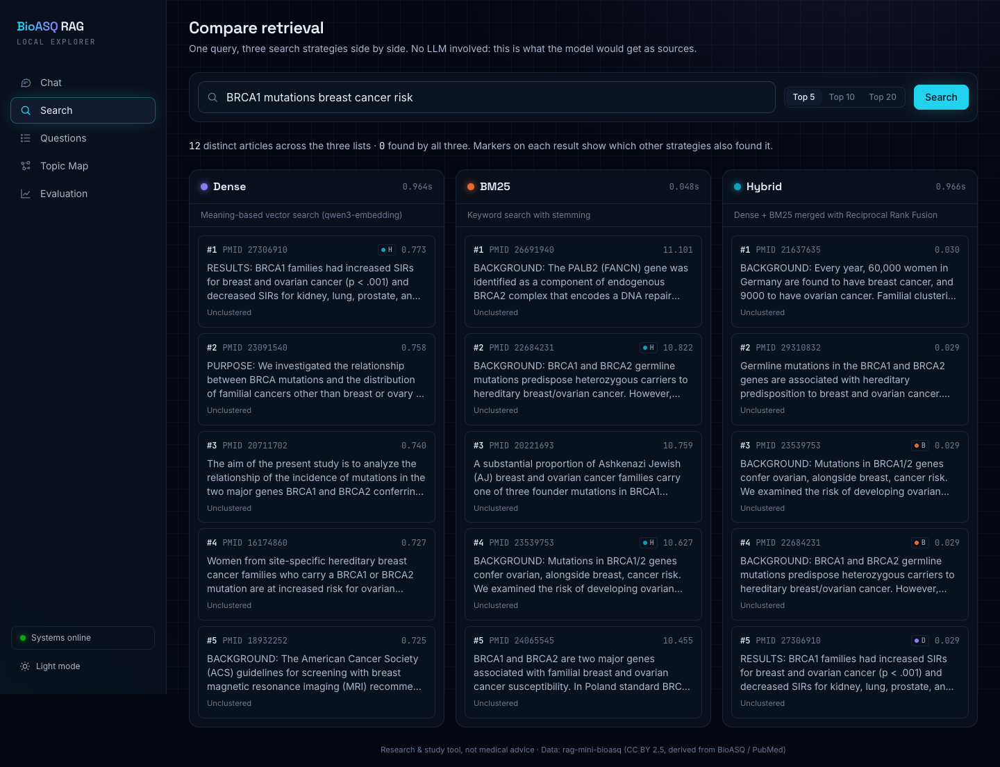
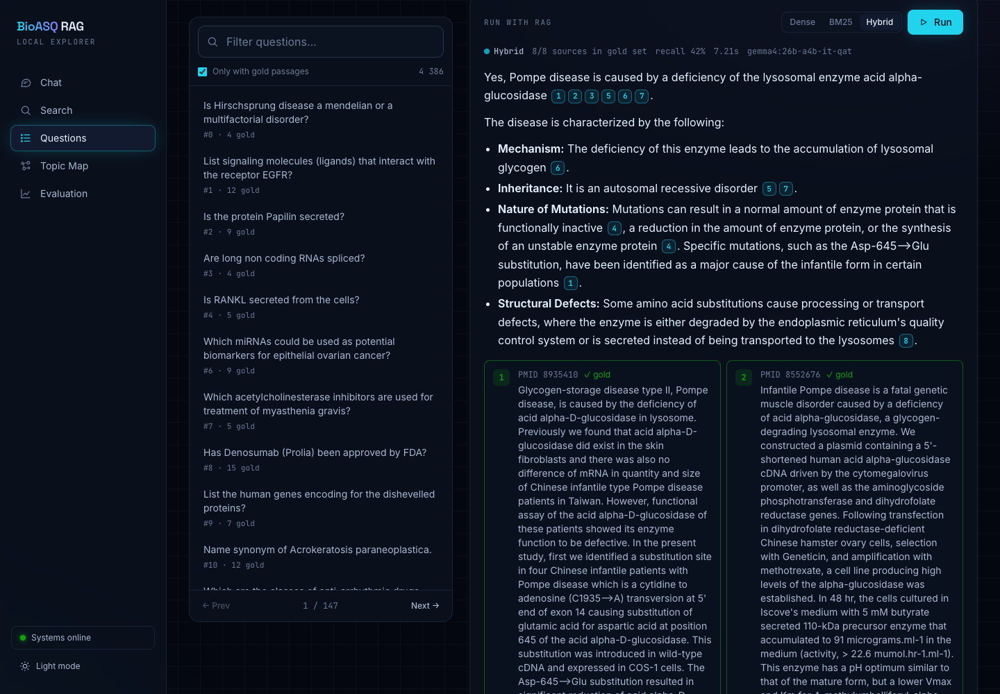
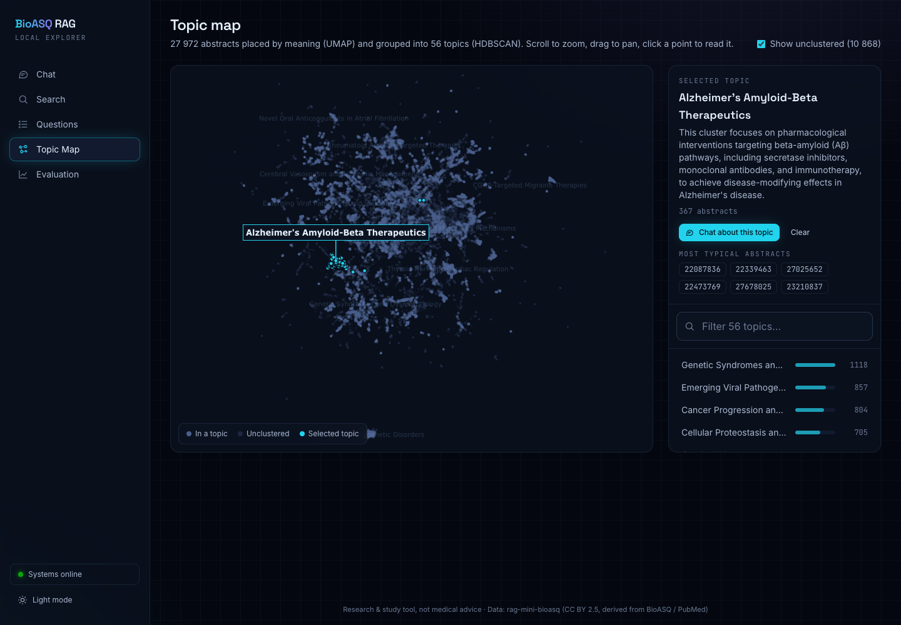
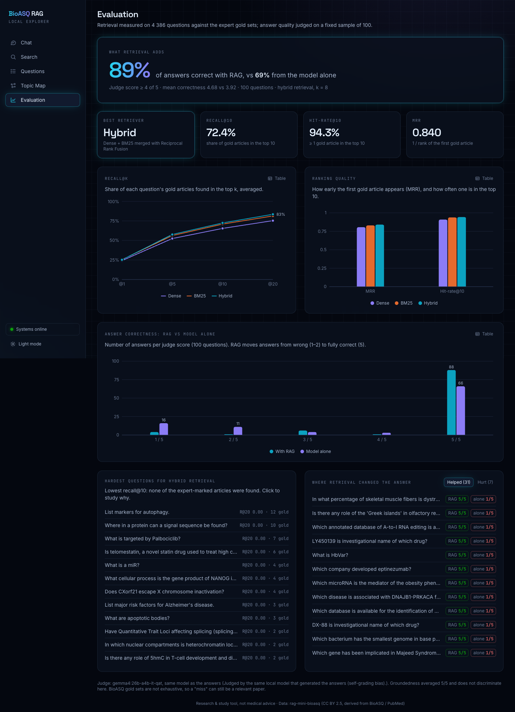
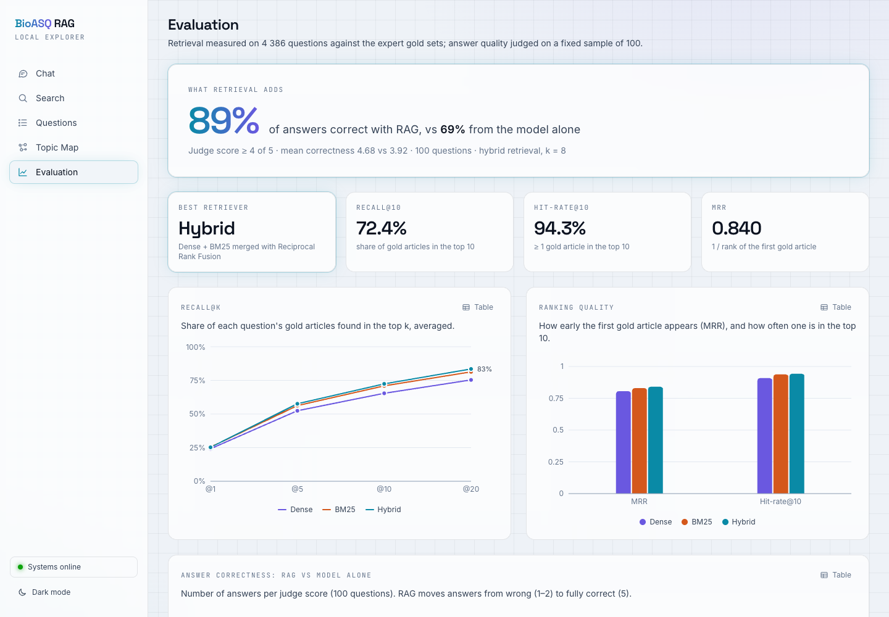
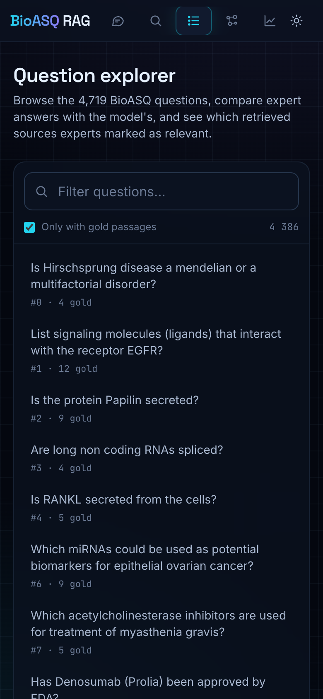

# BioASQ RAG Explorer

A retrieval-augmented generation (RAG) demo on the `rag-mini-bioasq` biomedical dataset: ask questions and get answers cited from PubMed abstracts, compare search strategies, check the model against expert answers, explore a topic map of the literature, and read the evaluation results.

> A research and study tool, not medical advice.



---

## At a glance

| | |
|---|---|
| Corpus | 27,972 PubMed abstracts (40,221 rows minus 12,249 empty or stub entries), split into 36,076 chunks |
| Questions | 4,719 BioASQ questions with expert answers; 4,386 have at least one usable gold abstract |
| Answer model | Gemma 4 26B A4B (QAT 4-bit, mixture-of-experts), ~58 tokens/s |
| Embeddings | `qwen3-embedding:0.6b`, 1,024-dimension vectors in ChromaDB |
| Retrieval | Dense vectors + BM25 keywords, merged with Reciprocal Rank Fusion |
| **Retrieval quality** | **Hybrid finds an expert-marked paper in the top 10 for 94.3% of questions** |
| **Answer quality** | **89% of answers correct with RAG vs 69% from the model alone** (100-question sample, LLM-judged) |
| Topics | 56 topics found by UMAP + HDBSCAN, named by the LLM |

---

## How it works

```
 PubMed abstracts ──clean & chunk──▶ 36,076 chunks ──embed──▶ ChromaDB (dense)
                                          └──────index──────▶ BM25 (keywords)

 Question ──▶ dense top 50 ┐
          └─▶ BM25 top 50  ┴─ Reciprocal Rank Fusion ─▶ top 8 articles
                                                              │
                         numbered sources + rules ────────────┘
                                   │
                         Gemma 4 26B ──stream──▶ answer with [1] [2] citations
```

1. **Prepare.** Remove the 12,249 empty or stub abstracts and normalize whitespace. Abstracts up to 2,000 characters stay whole; longer ones are split on sentence boundaries into chunks of up to 1,200 characters with overlap.
2. **Index.** Embed every chunk and build a BM25 keyword index.
3. **Retrieve.** Dense search captures meaning, BM25 catches exact gene and drug names, and Reciprocal Rank Fusion rewards articles that both methods agree on.
4. **Answer.** The model sees only the numbered sources, must cite them, and must say when the sources do not contain the answer.
5. **Evaluate.** Measure recall@k and MRR against the experts' gold articles, and have an LLM judge score answers with and without retrieval.
6. **Map.** Project each article's vector to 2D (UMAP), cluster it in 10D (HDBSCAN), and let the LLM name each cluster.

---

## The app

### Chat: answers grounded in the literature

Ask a question and the app retrieves sources, then streams an answer whose `[n]` citations are clickable chips. Settings: retrieval strategy, number of sources, model (26B or 12B) and optional thinking.



Clicking a citation opens the full abstract, with its topic and a link to PubMed:



### Search: three retrieval strategies side by side

The same query runs through dense, BM25 and hybrid search. Markers on each result show which other strategies also found it. This BRCA1 example shows how little the dense and keyword lists overlap.



### Question explorer: model vs experts

Browse all 4,719 BioASQ questions and see the expert answer, the gold articles and the stored retrieval metrics. **Run** answers a question live and marks each source that experts listed as relevant (green ✓ gold). In this run, all 8 sources were gold.



### Topic map: the shape of the corpus

27,972 abstracts placed by meaning, with 56 topics. Selecting a topic highlights it, lists its most typical abstracts, and offers **Chat about this topic**.



### Evaluation: what retrieval adds

The headline numbers, recall@k per strategy, ranking quality, the RAG vs model-alone score distribution, the hardest retrieval questions, and the questions where retrieval helped or hurt. Every chart has a table view.



A light theme is available (dark is the default), and the layout adapts to phone width:

| Light mode | Phone |
|---|---|
|  |  |

---

## Results

### Retrieval (4,386 questions, PubMed-ID level)

| Strategy | Recall@1 | Recall@5 | Recall@10 | Recall@20 | MRR | Hit@10 |
|---|---|---|---|---|---|---|
| Dense | 0.242 | 0.524 | 0.654 | 0.753 | 0.806 | 0.908 |
| BM25 | 0.254 | 0.562 | 0.709 | 0.813 | 0.829 | 0.938 |
| **Hybrid** | 0.252 | **0.576** | **0.724** | **0.835** | **0.840** | **0.943** |

**Finding:** keyword search (BM25) beats meaning-based search on this dataset, because BioASQ questions are full of exact gene, drug and disease names. Combining the two is best on every metric except recall@1.

### Answers (100 questions, hybrid retrieval, 8 sources)

| | Mean correctness (1–5) | Correct (score ≥ 4) |
|---|---|---|
| **With RAG** | **4.68** | **89%** |
| Model alone | 3.92 | 69% |

- **Fewer wrong answers:** retrieval turned 26 wrong answers into right ones; the model alone did better on 6.
- **Retrieval quality carries through:** correctness was 4.74 when a gold article was among the sources (91 questions) and 4.11 when none was (9).
- **Fewer invented numbers:** without sources the model invents specifics. For example, it guessed "3–10%" of muscle fibres restore dystrophin, where the paper reports nearly 100%.
- **Honest gaps:** 99 of 100 RAG answers cite their sources. In 4 cases the model said the sources did not contain the answer instead of guessing.

### Topics

56 topics, for example "Genetic Syndromes and Dysmorphology" (1,118 abstracts), "Emerging Viral Pathogens and Vaccines" (857), "Alzheimer's Amyloid-Beta Therapeutics" (367) and "CGRP-Targeted Migraine Therapies" (180).

### Caveats

- **Self-grading:** the judge is the same model that wrote the answers, so absolute scores are likely inflated. The RAG vs no-RAG comparison is the meaningful part.
- **Groundedness score:** the judge gave every RAG answer 5 out of 5 for groundedness, so that score does not discriminate yet.
- **Incomplete gold sets:** BioASQ gold lists are not exhaustive, so a "miss" can still be a relevant paper.
- **Unclustered abstracts:** about 39% of abstracts fall in no dense topic. The corpus covers all of biomedicine thinly.

---

## Tech stack

| Layer | Technology |
|---|---|
| Models | Ollama, Gemma 4 26B A4B (QAT), Gemma 4 12B (fallback), qwen3-embedding 0.6B |
| Data & retrieval | pandas, ChromaDB, bm25s + PyStemmer, NumPy |
| Topic map | UMAP, scikit-learn HDBSCAN |
| Backend | FastAPI, Server-Sent Events streaming, pydantic-settings, uv, pytest (95 tests) |
| Frontend | Vite, React 19, TypeScript, Tailwind CSS v4, TanStack Query, react-markdown, Plotly (WebGL), Recharts |

Chart colours were checked with a colour-vision-deficiency validator against both the dark and light surfaces.

## Known issues

- **Source cards** under an answer show the whole abstract instead of a 2-line preview (a CSS class conflict).
- **LaTeX in answers:** the model sometimes writes LaTeX such as `$\rightarrow$`, which is shown as raw text.
- **Slow first token:** time to first token can reach 6–30 s when the host is short on memory.

## Development

Setup, the data pipeline, configuration, evaluation details and the API reference are in [`docs/DEVELOPMENT.md`](docs/DEVELOPMENT.md). The original implementation plan is in [`bioasq-rag-plan.md`](bioasq-rag-plan.md).

## Dataset attribution

This project uses [`rag-datasets/rag-mini-bioasq`](https://huggingface.co/datasets/rag-datasets/rag-mini-bioasq), licensed under [CC BY 2.5](https://creativecommons.org/licenses/by/2.5/). It is derived from the [BioASQ](http://bioasq.org/) challenge data, built on PubMed abstracts.
